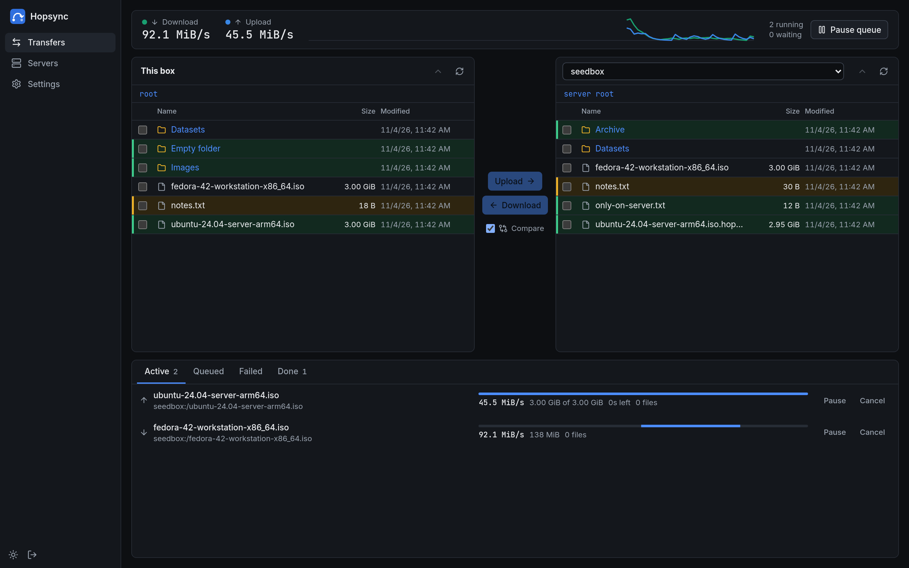
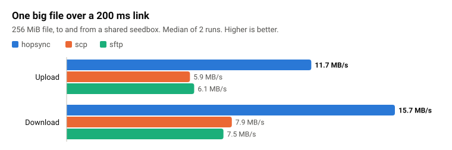
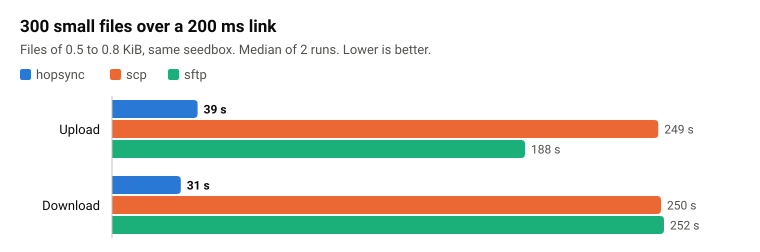
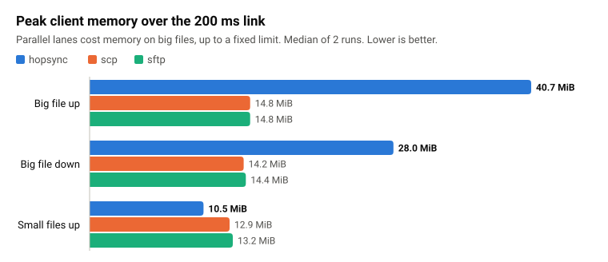
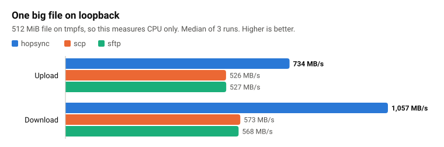
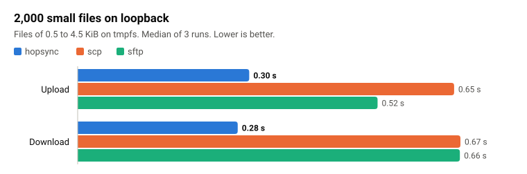
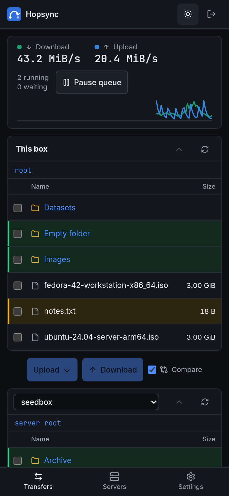

<p align="center"></p>

<h1 align="center">Hopsync</h1>

<p align="center">
  Fast file transfer between SSH servers, run from a web UI or the command line.<br>
  One binary. The other side needs only a normal SSH account with SFTP.
</p>

<p align="center">
  <a href="#install">Install</a> ·
  <a href="#performance">Performance</a> ·
  <a href="#quick-start">Quick start</a> ·
  <a href="#security">Security</a> ·
  <a href="#documentation">Documentation</a> ·
  <a href="#contributing">Contributing</a>
</p>

<picture>
  <source media="(prefers-color-scheme: light)" srcset="docs/assets/screens/transfers-light.png">
  
</picture>

> [!NOTE]
> Hopsync is early software. The transfer engine, daemon and web UI work and are tested, but there
> has been no independent security review. See [Project status](#project-status).

## Install

You do not need root. Run one of these on the box that will run transfers:

```bash
curl -fsSL https://github.com/YourNeelsOG/hopsync/releases/latest/download/install.sh | sh
```

```bash
wget -qO- https://github.com/YourNeelsOG/hopsync/releases/latest/download/install.sh | sh
```

Then start the service and web UI, and choose a password:

```bash
hopsync setup
```

To install an older release, set its tag. Every release stays available on the
[releases page](https://github.com/YourNeelsOG/hopsync/releases):

```bash
curl -fsSL https://github.com/YourNeelsOG/hopsync/releases/latest/download/install.sh | HOPSYNC_VERSION=v1.0.0 sh
```

Setup asks whether to open the web UI on the server's own address. If you say yes, it serves HTTPS at
`https://<server-ip>:7890` and prints the address. Plain `http://<server-ip>:7890` redirects there.

Your browser warns on the first visit, because the certificate is one the box made for itself and no
public authority vouches for a bare IP address. Compare the SHA-256 fingerprint in the warning with
the one setup printed, and accept it only if they match. If they differ, something is intercepting the
connection, so do not type your password. The daemon also writes the fingerprint to its log.

If you have a domain, use your own certificate instead, and browsers will not warn:

```bash
hopsync setup --tls-cert /path/to/fullchain.pem --tls-key /path/to/privkey.pem
```

The service account must be able to read both files, and a renewed certificate needs
`hopsync restart`.

If the page does not load, check the firewall first. Setup warns about `ufw`, but it cannot see a
firewall run by your provider, which you may need to open for that port.

To keep the web UI off the network, answer no, or run `hopsync setup --local-only`. It then listens
only on `127.0.0.1`, and you reach it through an SSH tunnel:

```bash
ssh -N -L 7890:127.0.0.1:7890 user@your-server
```

Then go to `http://127.0.0.1:7890`. The tunnel works in public mode too.

Setup asks which folder Hopsync may use. It refuses a home folder, because writing to `~/.ssh` or
`~/.bashrc` would let a web UI login run commands. Choose a subfolder such as `~/downloads`.

### See all your files

By default the web UI stays in that one folder. To see everything you already have, turn on full
access, either when setup asks, or at any time with:

```bash
hopsync setup --full-access
```

| The box has | The web UI reaches | Hidden from it |
|---|---|---|
| Root | The whole box, as root | `/proc`, `/sys`, `/dev` and `/run` |
| No root | Your home folder, as you | Anything hidden directly in your home, such as `~/.ssh`, `~/.bashrc` and `~/.config` |

> [!WARNING]
> With full access on a root box, anyone who gets your web UI password controls the server. They could
> overwrite system files, and files Hopsync writes belong to root. Use a long password, and prefer
> `--local-only` with an SSH tunnel if you can.

### Settings file

The same choice is in a file you can edit:

| The box has | File |
|---|---|
| Root | `/etc/hopsync/config.toml` |
| No root | `~/.config/hopsync/config.toml` |

```toml
access = "full"           # or "folder"
folder = "/srv/hopsync"   # used when access is "folder"
```

Apply a change with `hopsync restart`. `systemctl restart hopsync` alone does not apply it, because
the choice decides which account the service runs as. A mistake in the file stops with its line number
and changes nothing.

Check on the service with:

```bash
systemctl status hopsync
```

Setup uses what the box allows, and prints the commands that work on it:

| The box has | Hopsync runs as | Check it with |
|---|---|---|
| Root or sudo, and systemd | A system service, as an unprivileged user | `systemctl status hopsync` |
| No root, and `systemctl --user` works | A user service | `systemctl --user status hopsync` |
| No root and no `systemctl --user`, as on many shared seedboxes | A background process, restarted after a reboot through cron where allowed | `hopsync status` |

With no root, use `sudo` to get the system service instead, if you have it:

```bash
sudo ~/.local/bin/hopsync setup
```

`hopsync status`, `start`, `stop`, `restart` and `logs` work the same in all three. If the default port
is taken, for example by another customer on a shared box, setup picks the next free one.

Run `hopsync setup` again at any time: it keeps your folder, port and password, and restarts the
service only if something changed. For a new version, run the install command again, then
`hopsync setup`. To remove the service and binary, run `hopsync uninstall`, which keeps your files
and settings. `hopsync uninstall --purge` also deletes the settings, saved servers and keys.

The install script supports `x86_64`, `aarch64` and `armv7`, and checks the archive against
`sha256sums.txt`. Setup was tested under real systemd on Debian 12, Ubuntu 22.04 and Rocky 9.
The folder for your files cannot contain spaces. Setup refuses a root-owned folder, because Hopsync
never runs as root, and says how to fix it.

To install by hand, download the archive for your machine from
[Releases](https://github.com/YourNeelsOG/hopsync/releases), and copy `hopsync` to a folder on your
`PATH`.

The binary runs on Linux with glibc 2.17 or later, which covers CentOS 7 and every current Debian and
Ubuntu. It has been run on CentOS 7, Debian 10 to 12 and Ubuntu 20.04 to 24.04, all on a recent
kernel. It does not run on musl systems such as Alpine. Kernels older than 5.6 use a fallback to
confine paths, and no release has been tested on one.

To check a download, compare it with `sha256sums.txt` from the same release. Each archive also has a
signed record of the build that made it, which the [GitHub CLI](https://cli.github.com) can verify:

```bash
gh attestation verify hopsync-x86_64-linux.tar.gz --repo YourNeelsOG/hopsync
```

## Why Hopsync

`scp` and `sftp` move one stream at a time. On a long link, the SSH window limits that stream to a
few MB/s, and every small file costs several round trips. Hopsync runs on one box and pushes to or
pulls from any other box over SSH, with no agent to install there:

- **Parallel lanes.** One transfer opens several SSH connections and splits big files across them.
  Lanes start at 4 and grow to 16 while each new lane still adds speed.
- **Many small files at once.** Files stay in flight together, so the round-trip time is paid once
  per batch instead of once per file.
- **Resume after anything.** An interrupted file continues from its last durable chunk, even after
  `kill -9`.
- **Careful with your data.** Host keys are pinned, and a changed key stops the transfer. Existing
  files are skipped unless you choose otherwise. Data goes to `name.hopsync-part` and is renamed
  into place only when complete. `--verify` reads every chunk back and compares xxh3-128 hashes
  before the rename.
- **Light on the box.** Memory has a fixed limit that does not grow with file size. Page cache is
  dropped after streaming, so a shared seedbox keeps its cache for its own work. There are no
  temporary copies.

## Performance

Measured against OpenSSH `scp` and `sftp` on a shared seedbox about 200 ms away. Each tool used the
same server, key and data, one after another.





The speed has a cost. Parallel lanes use more memory than one stream on big files, up to a fixed
limit set by the lane count and buffer sizes:



<details>
<summary>Loopback charts and all numbers</summary>
<br>

Loopback uses tmpfs on both sides, so it measures CPU cost, not a disk or a network.





| 200 ms link, median of 2 runs | hopsync | scp | sftp |
|---|---:|---:|---:|
| Upload one 256 MiB file | **11.7 MB/s** | 5.9 MB/s | 6.1 MB/s |
| Download one 256 MiB file | **15.7 MB/s** | 7.9 MB/s | 7.5 MB/s |
| Upload 300 small files | **39.0 s** | 249.0 s | 188.2 s |
| Download 300 small files | **31.3 s** | 250.2 s | 251.5 s |
| Peak memory, upload one big file | 40.7 MiB | 14.8 MiB | 14.8 MiB |
| Peak memory, download one big file | 28.0 MiB | 14.2 MiB | 14.4 MiB |
| Peak memory, upload small files | 10.5 MiB | 12.9 MiB | 13.2 MiB |

| Loopback, median of 3 runs | hopsync | scp | sftp |
|---|---:|---:|---:|
| Upload one 512 MiB file | **734 MB/s** | 526 MB/s | 527 MB/s |
| Download one 512 MiB file | **1,057 MB/s** | 573 MB/s | 568 MB/s |
| Upload 2,000 small files | **0.30 s** | 0.65 s | 0.52 s |
| Download 2,000 small files | **0.28 s** | 0.67 s | 0.66 s |

</details>

These results have limits:

- The seedbox is shared, so other users' load varies between runs. Real-link results use only 2 runs
  because one `scp` tree run takes over 4 minutes.
- The real-link big-file runs last about 20 seconds, and that includes the time lanes take to ramp up.
- `rsync`, `rclone` and `lftp` are not compared yet. Neither is a 1 Gbps link.

[Method and caveats](docs/phase1/benchmarks.md) · [Medians as JSON](docs/benchmarks/results.json) ·
[Benchmark script](benches/bench.py) · [Chart script](benches/charts.py)

## Build from source

You need these on the machine that builds:

- Rust. `rust-toolchain.toml` pins the version.
- Node.js 20.19 or later, or 22.12 or later, with [pnpm](https://pnpm.io) 10. pnpm 9 stops with an
  error that names the version it needs. To use the pinned version without installing it, replace
  `pnpm` with `npx pnpm@10.34.7`.

```bash
cd crates/hopsync/web
pnpm install --frozen-lockfile
pnpm build
cd ../../..
HOPSYNC_REQUIRE_UI=1 cargo build --release
```

The result is `target/release/hopsync`, about 20 MB, with the whole web UI compiled in. Copy that
one file to your server. **The server does not need Node, npm or anything else from the build**, and
the UI never loads anything from another site at runtime.

A plain `cargo build` links against the glibc of the machine that builds, so the binary may refuse to
start on a server with an older one. [contrib/release/build.sh](contrib/release/build.sh) makes the
release builds, which avoid this.

If you build without the UI, the binary still works and its web page tells you how to add the UI.
`HOPSYNC_REQUIRE_UI=1` turns that case into a build error.

## Quick start

### Web UI

Run [`hopsync setup`](#install) on the box that will run transfers. The folder you choose is the only
local folder it can touch. The web UI listens on `127.0.0.1:7890`. To reach it on a remote box, run the
command that setup printed on your own PC:

```bash
ssh -L 7890:127.0.0.1:7890 you@your-box
```

Open <http://127.0.0.1:7890/> and log in with the password you chose in setup. There is no default
password.

To run the daemon by hand instead, use `hopsync serve --root ~/downloads`. Its log then names a file
holding a one-time setup token, and the page asks for that token once to set the password.

Then add a server under **Servers**. Compare the host key fingerprint with the one your provider
shows, and confirm it. Hopsync can create a key for that server and install it with the account
password once, so no password is stored. This works with servers that ask for the password by either
SSH method, but not with servers that also ask for a one-time code.

On **Transfers** you browse both sides, compare them, select files and folders, and copy them either
way. Before anything is queued, a preview shows what would be new, replaced or skipped. No question
interrupts a running job. Jobs can be paused, resumed, cancelled, retried and reordered, and they
survive a daemon restart. Each job has a page that lists every file and why it was skipped or failed.

<p align="center"></p>

### Command line

Pin the server's host key once:

```bash
hopsync hosts trust seedbox.example.com
```

Copy a file or a folder:

```bash
hopsync push -i ~/.ssh/id_ed25519 ./Images user@seedbox.example.com:downloads/
```

```bash
hopsync pull user@seedbox.example.com:downloads/Datasets ./
```

| Option | Effect |
|---|---|
| `--existing skip\|update\|overwrite\|rename` | What to do with files already at the destination. The default is `skip`. |
| `--verify` | Read everything back and compare it before the rename. |
| `-l N` / `--max-lanes N` | Fix the lane count, or cap the automatic one. |
| `--min-free 10G` | Refuse files that would leave less free space than this at the destination. |
| `--cache keep` | Keep transferred data in the page cache. The default drops it. |
| `--no-resume` | Do not record or use the resume journal. |

`hopsync push --help` lists every option.

The same binary also controls a running daemon over its local socket. Only your own user can use the
socket, so it needs no login.

```bash
hopsync servers
hopsync queue push seedbox Images/debian Images/debian --dry-run
hopsync jobs
hopsync job pause 12
```

### Run as a service

`hopsync setup` does this for you. [contrib/systemd](contrib/systemd) has the hardened system and user
units it installs, with steps at the top of each file for doing it by hand.

## Security

Hopsync holds SSH credentials for every server it reaches, so these are hard rules:

- Host keys are pinned. A changed key blocks the server until you review it.
- Local paths cannot leave their root (`openat2` with `RESOLVE_BENEATH`). Nothing runs through a
  shell, and no setting or API call can run a command.
- The web UI needs a login from first start. Stored keys are sealed with a key kept outside the
  database. Cross-origin and DNS-rebinding requests are refused.
- The UI has a strict Content Security Policy (`default-src 'self'`) and shows names from servers
  only as text. A browser test checks both, using a hostile file name.
- Dependencies are pinned by `Cargo.lock` and `pnpm-lock.yaml`. npm install scripts are off, and npm
  packages under 14 days old are refused.

Hopsync has no built-in TLS yet. Keep it on loopback behind an SSH tunnel, or put a TLS reverse proxy
in front and use `--secure-cookies`.

Every review so far was done by the people and tools that built the code, so none is independent.
Read them here: [engine](docs/phase1/security-review.md), [daemon](docs/phase2/security-review.md),
[web UI](docs/phase3/security-review.md), [React UI](docs/phase3/react-security-review.md),
[logins and releases](docs/phase4/security-review.md),
[install and setup](docs/phase4/install-security-review.md).

## Project status

| Area | State |
|---|---|
| Transfer engine and CLI | Done |
| Daemon, job queue and JSON API | Done |
| Web UI | Done |
| CI and release binaries (x86_64, aarch64, armv7) | Done |
| One-line install and `hopsync setup`, with or without root | Done |
| Built-in TLS, fuzzing | Not started |
| Packages (`.deb`, AUR, Docker) | Not started |
| Independent security review | Not started |
| Comparison with `rsync`, `rclone` and `lftp`, and a 1 Gbps test | Not started |

Known limits today:

- SSH key files must be ed25519 or ECDSA, without a passphrase. RSA keys and passphrase-protected keys
  are refused with a message that says so, and `ssh-agent` is not used. Keys that Hopsync creates
  avoid all of this.
- A server with only RSA host keys cannot be added. Most servers also have an ed25519 host key.
- The queue shows a percentage and time left only for a single-file upload. Downloads and folders
  show speed and bytes so far.
- A transfer runs between the box running Hopsync and one server. To copy between two other boxes,
  run Hopsync on one of them.
- Symlinks are skipped and reported.
- There is one admin account.

The roadmap and every design decision with its reason are in [plan.md](plan.md).

## Documentation

| Topic | Where |
|---|---|
| Design, roadmap and decision log | [plan.md](plan.md) |
| Benchmark method and results | [docs/phase1/benchmarks.md](docs/phase1/benchmarks.md) |
| Research on SSH libraries and link behavior | [docs/phase0](docs/phase0) |
| UX study of rclone, rsync, lsyncd and FileZilla | [docs/research/ux-study.md](docs/research/ux-study.md) |

## Development

```bash
cargo test --workspace
cd crates/hopsync/web
pnpm dev         # UI with hot reload, proxied to a daemon on 127.0.0.1:7890
pnpm test        # unit tests
pnpm typecheck
pnpm e2e         # browser test with a real daemon and sshd, needs Python playwright
pnpm e2e:password  # password key install against OpenSSH in a container, needs Docker
```

## Contributing

`main` is production and only the maintainer can change it. All new work goes to `dev` through a pull
request:


Create your branch from `dev`, and use `dev` as the base branch of your pull request. Research before
choosing a dependency, list edge cases before coding, add a test with every bug fix, and treat
security and the performance budget as features. The steps and checks are in
[CONTRIBUTING.md](CONTRIBUTING.md).

## License

Licensed under either of [Apache-2.0](LICENSE-APACHE) or [MIT](LICENSE-MIT), at your option.
